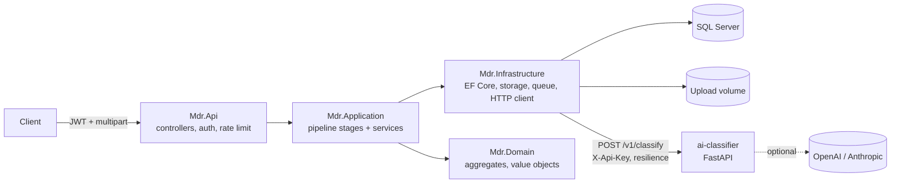
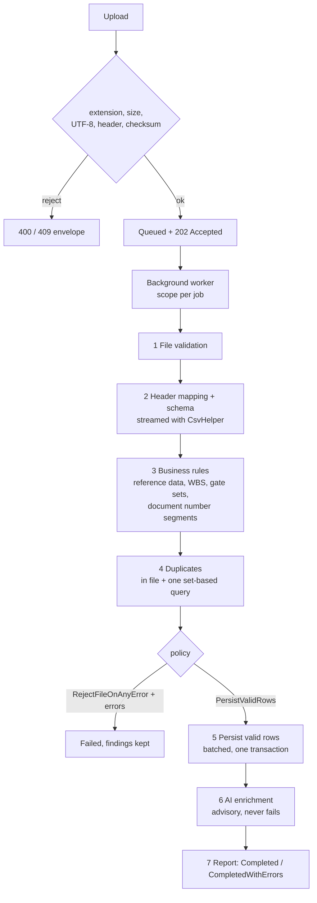
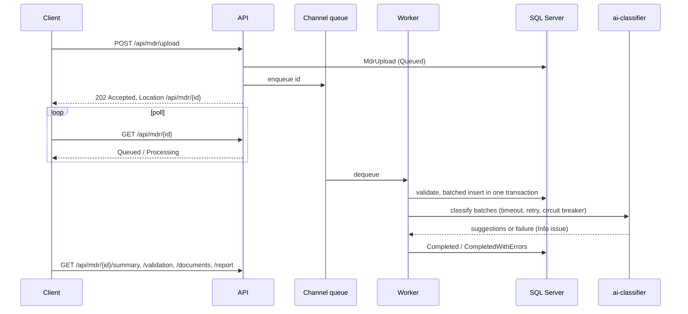
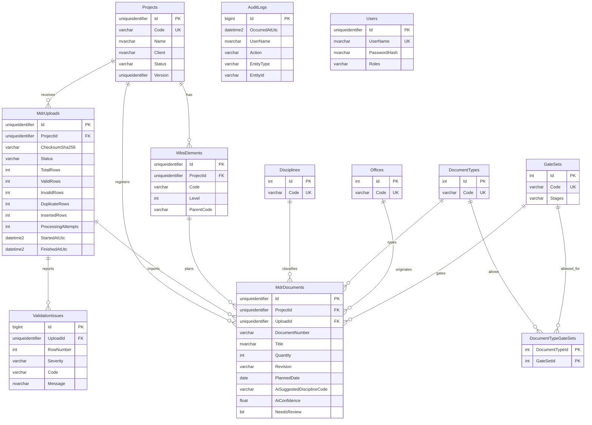
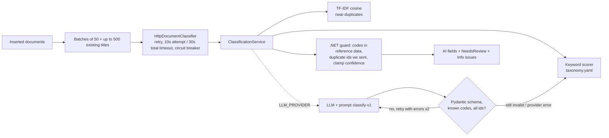

# MDR Document Platform

Enterprise backend for engineering document control: asynchronous ingestion and validation of Master Deliverables
Register (MDR) CSV files, with an advisory AI classification sidecar.

[](https://github.com/unmeshpawar7-cpu/mdr-document-platform/actions/workflows/ci.yml)
[](LICENSE)


> **Build status note:** the .NET solution was authored without a local .NET SDK. GitHub Actions CI is the source of
> truth for whether the .NET code builds and its tests pass. The Python sidecar was run locally (results below).

## Problem

On EPC and infrastructure projects the MDR is the contractual list of every deliverable - drawings, specifications,
datasheets, calculations - with its discipline, document type, WBS, gate set and planned date. Registers arrive as
spreadsheets from several offices; typical defects are malformed document numbers, numbers whose segments contradict
the row (a `MEC` number on an `ELE` row), unknown WBS codes, duplicates within and across submissions, and encoding
problems from Excel. Catching these by hand is slow and error-prone, and one bad row should not block a 5,000-row file.

## Solution

* `POST /api/mdr/upload` validates the cheap things synchronously (extension, size, UTF-8, header, duplicate file
  checksum) and returns **202 Accepted** with a `Location` to poll.
* A `BackgroundService` runs a staged pipeline - file, schema, business, duplicate detection, transactional
  persistence, AI enrichment, report - and records every finding with a stable code (`MDR001`-`MDR110`).
* Valid rows are persisted by default; an all-or-nothing policy is one setting away.
* A Python sidecar suggests discipline/type/category/priority and flags near-duplicate titles. Its output is advisory:
  it can only raise a `NeedsReview` flag, never change or reject data.

## Architecture



### CSV pipeline



### Upload sequence



More detail: [docs/architecture.md](docs/architecture.md), [CSV format](docs/csv-format.md),
[validation codes](docs/validation-codes.md), [API examples](docs/api-examples.md), [ADRs](docs/adr).

## Key Features

* Clean Architecture (.NET 8): Domain / Application / Infrastructure / Api with ports and adapters.
* Every pipeline stage is a separate interface, unit-tested in isolation, and chained by `MdrUploadProcessor`.
* 40 documented validation codes, a catalogue enforced by a unit test against `docs/validation-codes.md`.
* Document number parser (`NWP-001-PUN-MEC-DWG-0012`) with cross-checks against the row's office, discipline and type.
* Header mapping that ignores case, whitespace, punctuation and BOM, with aliases (`Doc No`, `Qty`, `Rev`, ...).
* Duplicate detection within a file (first row wins) and against the register with a single set-based query.
* Batched, transactional persistence; `PersistValidRows` (default) or `RejectFileOnAnyError` policy.
* Bounded `Channel<Guid>` + `BackgroundService` with configurable parallelism, per-job DI scopes, crash recovery,
  idempotent re-processing and an attempt cap.
* SHA-256 per project rejects re-uploads of identical files (`409`); files stored under generated names.
* Paginated, filterable validation issues and documents, per-upload summary (counts by discipline, type, gate set and
  severity, AI agreement rates, duration), CSV validation report with formula-injection protection, upload history,
  audit log.
* JWT auth with `Viewer` / `DocumentController` / `Admin` roles, rate-limited uploads and token requests.
* Python sidecar: YAML taxonomy scorer, TF-IDF duplicates, optional validated LLM classification.

## Technology Stack

| Area | Choice |
|---|---|
| API | ASP.NET Core 8 controllers, Swashbuckle 6.6, Serilog, built-in rate limiter, health checks |
| Data | EF Core 8 (SQL Server; SQLite for integration tests) |
| CSV | CsvHelper 33 (streaming `CsvParser`) |
| Validation | FluentValidation 11 (requests), domain invariants, pipeline stages (rows) |
| Resilience | Microsoft.Extensions.Http.Resilience 8.10 (`AddStandardResilienceHandler`) |
| Auth | JWT bearer, ASP.NET Core Identity `PasswordHasher<T>` |
| AI sidecar | Python 3.12, FastAPI, Pydantic v2, scikit-learn TF-IDF, httpx, tenacity |
| Tests | xUnit, FluentAssertions, NSubstitute, WebApplicationFactory; pytest, pytest-asyncio, pytest-cov |
| Ops | Docker (multi-stage, non-root), docker compose, GitHub Actions |

## Project Structure

```
mdr-document-platform/
├── src/
│   ├── Mdr.Domain/            aggregates, DocumentNumber, ValidationCodes
│   ├── Mdr.Application/       Processing/ (stages, orchestrator), Uploads/, Projects/, ports
│   ├── Mdr.Infrastructure/    Persistence/ (DbContext, configurations, Migrations), Csv/, Storage/,
│   │                          Background/, Classification/, Identity/, Auditing/
│   ├── Mdr.Api/               Controllers/, Infrastructure/ (middleware, exception handler), Program.cs
│   └── ai-classifier/         app/ (api, core, schemas, services, ai), tests/, pyproject.toml
├── tests/
│   ├── Mdr.UnitTests/         domain, every stage, worker, HTTP client, summary
│   └── Mdr.IntegrationTests/  WebApplicationFactory + SQLite end-to-end
├── samples/                   mdr-valid.csv, mdr-with-errors.csv, mdr-large-generator.py
├── docs/                      architecture, csv-format, validation-codes, api-examples, adr/
├── docker/                    api.Dockerfile, ai-classifier.Dockerfile
└── docker-compose.yml
```

## API Endpoints

| Method | Route | Auth | Description |
|---|---|---|---|
| POST | `/api/auth/token` | anonymous (rate limited) | Exchange credentials for a JWT |
| POST | `/api/projects` | DocumentController, Admin | Create project (201 + Location) |
| GET | `/api/projects` | any role | List projects (paged, `search`, `status`) |
| GET | `/api/projects/{id}` | any role | Project with WBS and counts |
| POST | `/api/projects/{id}/wbs` | DocumentController, Admin | Bulk-add WBS elements (parents first) |
| GET | `/api/projects/{id}/uploads` | any role | Upload history, newest first (paged) |
| GET | `/api/reference-data` | any role | Disciplines, document types, offices, gate sets |
| POST | `/api/mdr/upload` | DocumentController, Admin (rate limited) | Multipart `projectId` + `file`; **202** + Location |
| GET | `/api/mdr/{id}` | any role | Upload status and counters |
| GET | `/api/mdr/{id}/validation` | any role | Issues (paged; `severity`, `code`, `row`) |
| GET | `/api/mdr/{id}/documents` | any role | Documents (paged; `discipline`, `documentType`, `needsReview`) |
| GET | `/api/mdr/{id}/summary` | any role | Aggregates, AI review stats, duration |
| GET | `/api/mdr/{id}/report` | any role | CSV validation report download |
| GET | `/api/audit-logs` | Admin | Audit trail (paged; entity/action/user filters) |
| GET | `/health/live`, `/health/ready` | anonymous | Liveness; readiness (database, classifier as Degraded) |

Sidecar: `GET /health`, `GET /v1/taxonomy`, `POST /v1/classify` (`X-Api-Key`).

## Database Design



Unique `(ProjectId, DocumentNumber)` and `(ProjectId, ChecksumSha256)`; filtered indexes for pending uploads and
`NeedsReview`; covering indexes for paged listings. The `InitialCreate` migration and model snapshot in
`src/Mdr.Infrastructure/Persistence/Migrations` were **hand-written to match the model** (no SDK was available);
`dotnet ef migrations add <Name> --project src/Mdr.Infrastructure --startup-project src/Mdr.Api` can regenerate them.

## AI Architecture



* **Offline by default.** `LLM_PROVIDER=offline` uses a deterministic weighted-keyword scorer: title matches count
  double, confidence combines evidence strength and the margin over the runner-up code, and the rationale lists the
  matched keywords. It is a heuristic, not a model. On the bundled 40-row sample it agrees with the provided
  discipline and type for 40/40 rows - but the taxonomy was written alongside that sample, so this is a regression
  check, **not** a measure of real-world accuracy.
* **Near duplicates** always use scikit-learn TF-IDF (word uni/bi-grams, English stop words) with cosine similarity
  against earlier items in the batch and existing project titles (threshold 0.85).
* **LLM option** (`openai` / `anthropic`): versioned prompt file `app/ai/prompts/classify/v1.md`; JSON output parsed
  and validated with Pydantic; every requested id must be present, no unknown ids, codes must be in the taxonomy;
  validator errors are fed back for up to 2 retries, then the batch falls back to the offline scorer.
  Transient provider failures (429/5xx/transport) are retried with tenacity. Tests mock providers with
  `httpx.MockTransport`; no test touches the network. No live LLM call was made while building this repo.
* **Versioning:** each document stores `AiClassifierVersion` (`taxonomy-2026.10+tfidf-1`, or
  `llm-<provider>-<model>+prompt-classify-v1+tfidf-1`).
* **Hallucination mitigation:** known-code checks on both sides, duplicate ids must be ids the API sent, provided values
  are never overwritten, low confidence or disagreement only raises `NeedsReview`.
* **Cost/tokens:** provider usage (or a 4-chars-per-token estimate) is returned in `usage` and logged with provider,
  model, prompt version, attempts and latency - never the document text or keys.

## Security

* JWT bearer (HS256; signing key >= 32 chars from environment, validated at startup), role policies, generic 401
  messages, dummy-hash verification for unknown users.
* Passwords hashed with ASP.NET Core Identity PBKDF2; demo users are seeded **only in Development** from configuration.
* Upload limits enforced three times: declared length, multipart/Kestrel body limits, and a byte counter while
  streaming. Strict UTF-8 decoding; NUL bytes rejected.
* Client file names are display-only (sanitised); storage uses `yyyy/MM/{guid}.csv` with a path-traversal guard.
* Fixed-window rate limits per user (uploads) and per IP (tokens); `429` uses the error envelope.
* CSV report neutralises formula injection (`=`, `+`, `-`, `@`, tab, CR prefixes).
* Sidecar requires `X-Api-Key` (constant-time compare); secrets only via environment (`.env.example` has placeholders).
* Exceptions map to envelopes without stack traces; every response carries `X-Correlation-Id`.

## Testing

```bash
# .NET (requires the .NET 8 SDK) - CI runs exactly this
dotnet test Mdr.sln -c Release --collect:"XPlat Code Coverage"

# Python sidecar
cd src/ai-classifier && python -m venv .venv && . .venv/bin/activate && pip install -e ".[dev]"
ruff check . && pytest --cov=app
```

* **Unit tests (.NET):** document number parser, upload state machine and counters, WBS hierarchy, AI review logic,
  header mapping (aliases, BOM, duplicates, unknown columns), every row-level validation code, file encoding checks,
  duplicate detection in file and against the register (asserting one query), persistence batching/transaction and
  both policies, AI enrichment (disagreement, low confidence, unknown codes, unknown duplicate ids, outage, exceptions,
  cancellation), the full pipeline over both sample files with fakes, CSV reader/report writer, local storage
  (hashing, size limit, traversal), Channel back-pressure, worker scopes/failure isolation/crash recovery, the HTTP
  classifier with a stubbed `HttpMessageHandler`, summary aggregation, upload and project services.
* **Integration tests (.NET):** `WebApplicationFactory<Program>` with SQLite and a fake classifier: auth and roles,
  project/WBS endpoints, the full sample flow (202 -> poll -> counters 27/6/21/2/6 -> validation filters -> documents ->
  summary -> CSV report -> 409 on re-upload -> history -> audit), 400 envelopes, background header failures,
  classifier outage, 404s and the upload rate limit. SQLite runs as a temporary file in WAL mode instead of a single
  shared in-memory connection because the background worker and polling requests use the database concurrently.
* **Not verified locally:** the .NET code has not been compiled or run here (no SDK in the authoring environment);
  CI is the source of truth. Static checks (syntax parse, project references, central package versions) pass.
* **Python sidecar (measured):** 51 tests passed, **99% line coverage** (`pytest --cov=app`), `ruff check` clean.

## Running Locally

Prerequisites: .NET 8 SDK, SQL Server (or `docker compose up sqlserver`), Python 3.12 for the sidecar.

```bash
# 1. Sidecar
cd src/ai-classifier && pip install -e . && CLASSIFIER_API_KEY=local-dev-key-0123456789 \
  uvicorn app.main:create_app --factory --port 8000

# 2. API (Development: Swagger + demo users admin / controller / viewer, see appsettings.Development.json)
export ConnectionStrings__MdrDatabase="Server=localhost,1433;Database=MdrDocumentPlatform;User Id=sa;Password=<pwd>;TrustServerCertificate=True"
export Database__ApplyMigrationsOnStartup=true Classifier__Enabled=true Classifier__ApiKey=local-dev-key-0123456789
dotnet run --project src/Mdr.Api   # http://localhost:5080/swagger
```

Then follow [docs/api-examples.md](docs/api-examples.md): token, project, WBS, upload `samples/mdr-valid.csv` and
`samples/mdr-with-errors.csv` (see [samples/README.md](samples/README.md) for which row triggers which code).
`python samples/mdr-large-generator.py --rows 20000` produces a load-test file.

## Docker

```bash
cp .env.example .env    # set MSSQL_SA_PASSWORD, JWT_SIGNING_KEY, CLASSIFIER_API_KEY
docker compose up --build
# API http://localhost:8080/swagger   sidecar http://localhost:8000/health
```

Compose starts SQL Server 2022, the classifier and the API with healthchecks and `depends_on: service_healthy`,
applies migrations on startup, and keeps uploads on the `mdr-uploads` volume. Both images are multi-stage and run as
non-root users.

## Example API Request

```bash
curl -si http://localhost:8080/api/mdr/upload \
  -H "Authorization: Bearer $TOKEN" \
  -F projectId=$PROJECT -F file=@samples/mdr-with-errors.csv
```

## Example API Response

```
HTTP/1.1 202 Accepted
Location: /api/mdr/3f6c0d8e-7a51-4c1e-9a43-0b6f2d7f1c11
X-Correlation-Id: 6d1f0c2b9a8e4f3d
```
```json
{ "success": true,
  "data": { "uploadId": "3f6c0d8e-7a51-4c1e-9a43-0b6f2d7f1c11", "projectId": "9b1e5c3a-...", "status": "Queued",
            "statusUrl": "/api/mdr/3f6c0d8e-7a51-4c1e-9a43-0b6f2d7f1c11", "uploadedAtUtc": "2026-10-08T09:15:02.113Z" },
  "message": "Upload queued for processing." }
```

Polling `GET /api/mdr/{id}` then returns `"status": "CompletedWithErrors"` with
`"counters": { "totalRows": 27, "validRows": 6, "invalidRows": 21, "duplicateRows": 2, "insertedRows": 6 }`
(when `mdr-valid.csv` was uploaded first). IDs and timings above are illustrative.

## Future Enhancements

* `SqlBulkCopy` / table-valued parameters for six-figure row counts; streaming persistence for very large files.
* Durable queue (Azure Service Bus) or periodic sweep for abandoned `Queued` uploads; multi-instance workers.
* Revision workflow: accept re-submitted rows as new revisions instead of `MDR021` duplicates.
* Reference data administration endpoints (Admin role) with caching and change audit.
* Blob storage implementation of `IFileStorage`; antivirus scanning hook before processing.
* Evaluation set of real (anonymised) MDR titles to measure classifier precision/recall per discipline.
* OpenTelemetry traces across API, worker and sidecar.

## Engineering Highlights

* **Asynchronous by design, durable by database.** The HTTP request does only what must be synchronous for a good
  client experience (bad file -> 400, duplicate file -> 409) and hands off an id. The channel is a transport, not a
  store: status lives in SQL, so a crash costs a re-run, not data. Re-processing deletes partial results first, making
  jobs idempotent - simpler than distributed exactly-once semantics, and sufficient for a single-node worker (ADR 0001).
* **One pass, every error.** Stages never short-circuit a row: schema failures are passed on as `null` so business
  rules skip them instead of double-reporting, and a user gets the complete list of problems per row in one report.
* **Set-based where it matters.** Duplicate lookup is one query with a JSON parameter (OPENJSON / json_each) for the
  whole file; summaries group by foreign key in the database and map ids to codes in memory.
* **Transactions sized for imports.** Batched `SaveChanges` with detach inside one transaction keeps memory flat and
  commits atomically. Retry-on-failure is deliberately off because it does not compose with user transactions;
  retries happen at the job level instead.
* **AI that cannot corrupt the register.** The classifier is enrichment after commit, its codes are re-validated by the
  API, and its only power is to set `NeedsReview`. The offline heuristic is honest about being a heuristic and keeps
  the system fully functional with no API keys.
* **Trade-offs accepted:** in-process queue limits horizontal scale; hand-written migration needs regeneration review;
  the integration tests use SQLite, so SQL Server-specific behaviour (filtered/covering index usage, OPENJSON) is
  exercised only in production-like environments.
