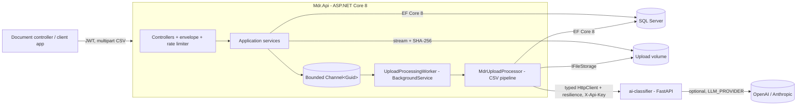
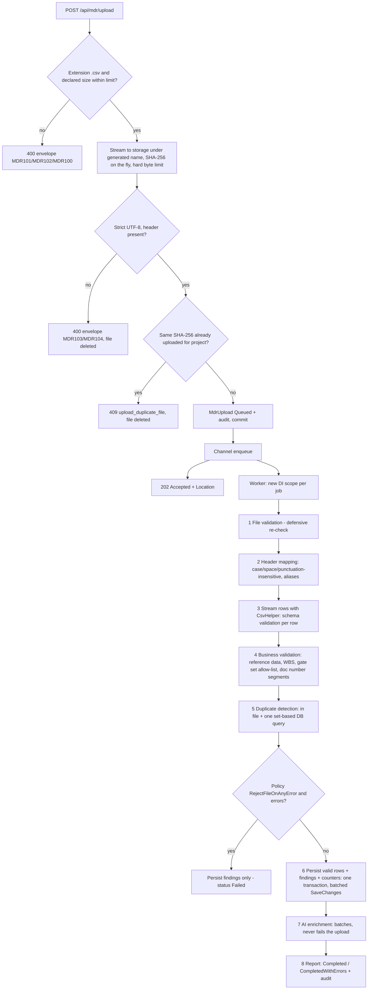

# Architecture

The platform ingests Master Deliverables Register (MDR) spreadsheets exported as CSV, validates every row against
project and reference data, stores the valid deliverables and enriches them with **advisory** AI suggestions.

## Components



| Project | Responsibility | Depends on |
|---|---|---|
| `Mdr.Domain` | Aggregates (`Project`/`WbsElement`, `MdrUpload`, `MdrDocument`), reference data, `DocumentNumber` value object, validation code catalogue. No framework dependencies. | - |
| `Mdr.Application` | Pipeline stages behind interfaces, orchestrator, upload/project/query services, ports (repositories, unit of work, storage, queue, classifier), FluentValidation validators, summary builder. Uses only `Microsoft.Extensions.*` abstractions from the shared framework (no HTTP/MVC types). | Domain |
| `Mdr.Infrastructure` | EF Core (SQL Server) context, configurations, hand-written migration, repositories and read projections, CsvHelper reader/report writer, local file storage, Channel queue + BackgroundService, HTTP classifier client, JWT + PasswordHasher auth, audit trail. | Application |
| `Mdr.Api` | Controllers, envelope, global `IExceptionHandler`, correlation-id middleware, Serilog, JWT bearer + role policies, rate limiting, Swagger, health checks. | Application, Infrastructure |
| `src/ai-classifier` | Python FastAPI sidecar: taxonomy keyword scorer, TF-IDF duplicates, optional LLM provider with validated output. | - |

Reads use a CQRS-lite split: commands go through repositories and aggregates; queries (`IMdrQueries`,
`IProjectQueries`, `IAuditLogQueries`) project straight to DTOs with `AsNoTracking` and paging in the database.

## CSV pipeline



Each stage is an interface in `Mdr.Application.Processing.Stages` and is unit-tested in isolation. Rows are streamed;
only the compact parsed representation of candidate rows and the document numbers are held in memory, which is what
duplicate detection needs. File-level problems stop processing with status `Failed`; row-level problems never do.

## Upload sequence (202 + background processing + polling)

```mermaid
sequenceDiagram
    autonumber
    participant C as Client
    participant A as Mdr.Api
    participant S as IFileStorage
    participant DB as SQL Server
    participant Q as Channel queue
    participant W as UploadProcessingWorker
    participant AI as ai-classifier

    C->>A: POST /api/mdr/upload (projectId, file) + Bearer JWT
    A->>A: role CanManage, rate limit, size/extension checks
    A->>S: stream file to yyyy/MM/{guid}.csv (SHA-256)
    A->>DB: checksum exists for project?
    A->>DB: INSERT MdrUpload (Queued) + AuditLog
    A->>Q: Enqueue(uploadId)
    A-->>C: 202 Accepted, Location: /api/mdr/{id}
    loop until terminal
        C->>A: GET /api/mdr/{id}
        A-->>C: status Queued | Processing, counters
    end
    W->>Q: dequeue (max parallel N)
    W->>DB: Processing, attempts+1
    W->>S: open stored file (stream)
    W->>W: validate rows, detect duplicates
    W->>DB: BEGIN; batched INSERT documents + issues; counters; COMMIT
    W->>AI: POST /v1/classify (batches of 50, X-Api-Key, resilience handler)
    AI-->>W: suggestions (or failure -> MDR050 Info)
    W->>DB: AI fields, NeedsReview, Info issues, Completed/CompletedWithErrors
    C->>A: GET /api/mdr/{id}
    A-->>C: CompletedWithErrors + counters
    C->>A: GET /api/mdr/{id}/validation | /documents | /summary | /report
```

## Background processing and crash recovery

* `ChannelUploadQueue` is a bounded `Channel<Guid>` (`MdrProcessing:QueueCapacity`, default 100, `FullMode = Wait`):
  producers wait instead of dropping work. The database is the source of truth; the channel only carries ids.
* `UploadProcessingWorker` consumes with `Parallel.ForEachAsync` (`MdrProcessing:MaxParallelUploads`, default 2),
  creates an `AsyncServiceScope` per job (own DbContext), logs with an `UploadId` scope and contains failures per job.
* On startup it re-enqueues every upload still `Queued` or `Processing`. Consumption starts before recovery so a backlog
  larger than the queue capacity cannot deadlock.
* An upload found in `Processing` is an interrupted attempt: its partial documents/issues are removed with set-based
  `ExecuteDeleteAsync` before re-running, so re-processing is idempotent. `ProcessingAttempts` is capped
  (`MaxProcessingAttempts`, default 3) to stop poison files looping.
* Shutdown cancels the job; the upload stays `Processing` and is recovered on next start.

Known limitation: an upload whose enqueue was abandoned (client disconnected while the bounded queue was full) stays
`Queued` until the next restart. A periodic sweep (or a durable broker, see ADR 0001) would close that gap.

## Persistence

* SQL Server via EF Core 8. Entity configurations in `Persistence/Configurations`; reference data via `HasData`.
* Indexes: unique `(ProjectId, DocumentNumber)`, unique `(ProjectId, ChecksumSha256)`, `(ProjectId, UploadedAtUtc)`
  for history, filtered `Status IN ('Queued','Processing')` for recovery, filtered `NeedsReview = 1`, covering
  `(UploadId, SourceRowNumber) INCLUDE (DocumentNumber, NeedsReview)` and `(UploadId, RowNumber) INCLUDE (Severity, Code)`.
* Optimistic concurrency with a `Guid Version` concurrency token regenerated by the aggregates (portable to SQLite,
  unlike `rowversion`); conflicts surface as `409`.
* `InitialCreate` migration and model snapshot were **hand-written** to match the model because the .NET SDK was not
  available while authoring; `dotnet ef migrations add` regenerates them. Migrations run at startup only when
  `Database:ApplyMigrationsOnStartup=true` (docker-compose sets it).
* Bulk insert: `AddRange` + `SaveChanges` per batch of `PersistenceBatchSize` (default 500) inside one explicit
  transaction, detaching each saved batch so the change tracker stays small. `SqlBulkCopy` (or EFCore.BulkExtensions)
  is the next step for very large files; it was not used because it bypasses the change tracker, generated keys and the
  SQLite-backed integration tests.
* `EnableRetryOnFailure` is deliberately off: retrying execution strategies conflict with user-initiated transactions
  and batched detach. Retries happen at job level (recovery + attempt counter).

## AI enrichment

* `IDocumentClassifier` lives in Application. `HttpDocumentClassifier` (typed `HttpClient`) uses
  `AddStandardResilienceHandler()` (retry, attempt timeout 10 s, total timeout 30 s, circuit breaker). Any failure becomes
  `ClassificationResponse.Unavailable`; only caller cancellation propagates. `NullDocumentClassifier` is registered when
  `Classifier:Enabled=false`.
* Suggestions are sanitised before use: codes must exist in reference data (else `MDR056`), priorities must parse,
  `potentialDuplicateOf` must reference an id that was actually sent, confidence is clamped to [0, 1].
* The domain never overwrites the provided discipline/type. `NeedsReview` is raised on disagreement, low confidence
  (`AiLowConfidenceThreshold`, default 0.6) or a duplicate hint; reasons are recorded as `Info` issues.

## Security

JWT bearer (HS256, key from environment), roles `Viewer` < `DocumentController` < `Admin` as policies, PBKDF2 password
hashing via `PasswordHasher<T>`, constant-ish time login (dummy hash for unknown users), per-user fixed-window upload
rate limit and per-IP token rate limit, multipart and Kestrel body limits just above the file limit, a second
byte-counting limit while streaming, generated storage names with a path-traversal guard, strict UTF-8 decoding,
formula-injection-safe CSV report and an `X-Api-Key` shared secret between API and sidecar (compared with
`secrets.compare_digest`). Errors never leak exception details; every response carries a correlation id.
